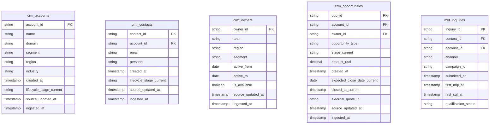
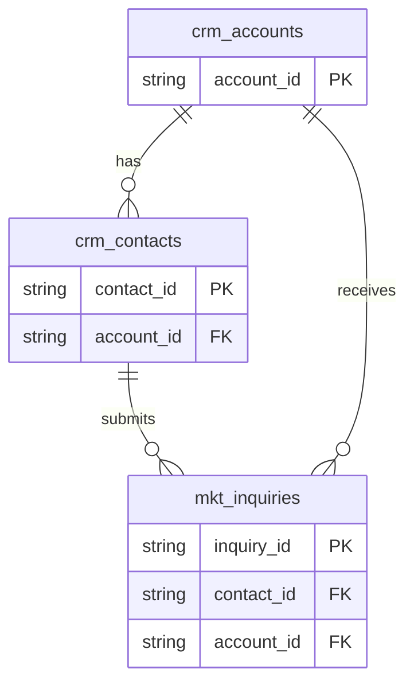
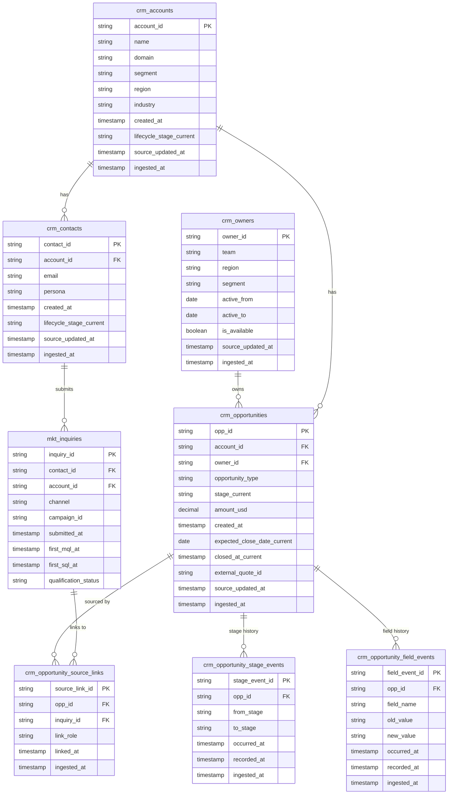

# CRM Data Modeling

This page walks through how I model CRM data for analytics, using **Fiction Cloud**, a fictional B2B SaaS company whose lead-to-revenue data I built in DuckDB and dbt. It covers three things:

1. **The core CRM tables**: what each one holds and why it matters.
2. **Data types**: how CRM field types (HubSpot shown here) translate into database types.
3. **Keys and relationships**: how primary and foreign keys connect the tables, and how dbt tests prove those connections hold.

---

## 1. Core CRM Tables

Most CRMs (HubSpot, Salesforce, Pipedrive) are built on the same handful of objects. The names differ by vendor, but the shape is consistent.

| Common name | Fiction Cloud table | What it holds |
|---|---|---|
| Companies / Accounts | `crm_accounts` | One row per company you sell to. The account is the anchor of the CRM: contacts, deals and revenue all roll up to it, so it's where segment, region and industry live. |
| Leads | `mkt_inquiries` | One row per inbound signal, such as a form fill, demo request or event scan. Fiction Cloud tracks leads as marketing **inquiries** tied to a contact, so one person can raise their hand several times and each one is counted. MQL and SQL timestamps are recorded on the inquiry. |
| Contacts | `crm_contacts` | One row per person at an account. Contacts carry persona and lifecycle stage, and they're the link between marketing activity (who engaged) and sales activity (who's in the deal). |
| Deals / Opportunities | `crm_opportunities` | One row per potential sale, with amount, stage, owner and expected close date. This is the table pipeline and bookings reporting is built on. It only stores each deal's *current* state. |
| Opportunity events | `crm_opportunity_stage_events`, `crm_opportunity_field_events` | One row per change to a deal: a stage move, or a field edit such as a pushed close date. These tables keep the history that the opportunity table overwrites, which is what makes questions like "what did pipeline look like at month-end?" answerable. |
| Owners | `crm_owners` | One row per rep, with team, region, segment and active dates. Owners connect deals to the people accountable for them, which drives quota, capacity and territory reporting. |

### Standard CRM Data Model

The five core objects and their columns:



---

## 2. Translating CRM Field Types to Database Types

CRMs describe fields in business terms ("Number", "Dropdown select"). A warehouse needs exact types. Getting this right in the staging layer means math works, dates sort and filter correctly, and joins don't silently fail because one side is text and the other is a number.

| HubSpot field type | Example property | Database type | Notes |
|---|---|---|---|
| Number | Annual Revenue, Amount | `DECIMAL(18,2)` | Use a fixed-precision decimal for money, never a float, so totals don't drift by fractions of a cent. Fiction Cloud stores `amount_usd` as `DECIMAL(18,2)`. |
| Single-line text | City, Domain | `VARCHAR` | Trim whitespace and convert empty strings to `NULL` in staging. |
| Multi-line text | Description, Notes | `VARCHAR` | Usually kept out of reporting models. |
| Single checkbox | Is Public | `BOOLEAN` | Exports arrive as `"true"` / `"false"` text and need an explicit cast. |
| Multiple checkboxes | Products of Interest | `VARCHAR` or `VARCHAR[]` | HubSpot exports these as one semicolon-separated string. Split into an array or a child table if you need to filter on them. |
| Dropdown select / Radio select | Lifecycle Stage, Industry | `VARCHAR` | Store HubSpot's internal value, not the display label, and enforce the allowed list with an `accepted_values` test. |
| Date picker | Expected Close Date | `DATE` | No time component. |
| Date and time picker | Create Date, Last Modified | `TIMESTAMP` | Standardize to UTC. |
| HubSpot user | Deal Owner | `VARCHAR` / `BIGINT` | This is an ID, so treat it as a foreign key to the owners table rather than as a name. |
| Record ID | Company ID, Deal ID | `VARCHAR` / `BIGINT` | The primary key. |

In this project the raw CSVs land as text and the dbt staging models do the casting, e.g. `created_at::timestamp` and `NULLIF(trim(domain), '')`, so every downstream model can rely on clean, typed columns.

---

## 3. Primary Keys and Foreign Keys

A **primary key (PK)** is the column that uniquely identifies each row in a table, such as `account_id` in `crm_accounts`. It must be unique and never null. A **foreign key (FK)** is a column in one table that points to the primary key of another, such as `account_id` in `crm_contacts`, which says which company a person works at.

Keys matter in the analytical layer because every metric is a join. "Pipeline by region" joins opportunities to accounts. "MQLs by persona" joins inquiries to contacts. If a primary key has duplicates, the join double-counts revenue. If a foreign key points to a record that doesn't exist, rows quietly drop out of reports. Declaring keys up front, and testing them, is what makes the numbers trustworthy.

---

## Relationships

A relationship describes how rows in one table connect to rows in another, for example "one account has many contacts". Relationships are what let a business follow a single thread from the first form fill to closed revenue. Without them, marketing, sales and finance each report numbers that can't be reconciled.

**Accounts**
The account is the central record in a CRM. Almost every other object points back to it. Contacts, inquiries and opportunities each carry an `account_id`, which makes the account the level where marketing engagement, pipeline and revenue meet. In Fiction Cloud, all 240 accounts have at least one contact (between 1 and 7 each).

**Contacts**
Each contact belongs to exactly one account (`crm_contacts.account_id → crm_accounts.account_id`), and one account can have many contacts. Contacts are also the parent of inquiries, so they connect *who engaged* with *which company engaged*.

**Inquiries**
Each inquiry is submitted by one contact (`mkt_inquiries.contact_id → crm_contacts.contact_id`) and also records the account (`mkt_inquiries.account_id → crm_accounts.account_id`). One contact can submit many inquiries: Fiction Cloud has 960 inquiries from 483 contacts, and one contact submitted 7. That's why "number of MQLs" and "number of people who became MQLs" are different metrics. In this data the inquiry's account always matches its contact's account.



*How to read the lines:* `||` means "exactly one" and `o{` means "zero or more". So `crm_accounts ||--o{ crm_contacts` reads as "one account has zero or more contacts."

---

## Data Validation Checks

Keys and relationships are only promises until something checks them. In dbt, I declare these rules next to each model in YAML, and `dbt test` turns each rule into a SQL query that fails if any row breaks it. The checks run on every build, so a bad CRM sync or a broken import is caught before it reaches a dashboard. Across the project, 89 tests cover keys, relationships and allowed values.

**Snippet 1: primary key test** (from `models/staging/crm/_crm_models.yml`)

```yaml
  - name: stg_crm_accounts
    columns:
      - name: account_id
        data_tests:
          - unique
          - not_null
```

This checks that every account has an ID and that no ID appears twice. If a CRM export duplicated an account, every join to accounts would double-count that account's pipeline and revenue. This test catches that at the source.

**Snippet 2: foreign key (relationship) test** (from the same file)

```yaml
  - name: stg_crm_contacts
    columns:
      - name: account_id
        data_tests:
          - relationships:
              arguments:
                to: ref('stg_crm_accounts')
                field: account_id
```

This checks that every contact's `account_id` exists in the accounts table, so there are no orphaned contacts pointing at a company that was deleted or never synced. Orphans are a common cause of reports that don't add up: the contact counts in a total but disappears from any breakdown by segment or region. The same pattern checks opportunities → accounts, opportunities → owners, and inquiries → contacts.

---

## Full CRM Schema (Fiction Cloud `core-v1`)

The complete set of raw CRM tables, built from the CSVs in `data/core-v1/raw/crm/`. There is no standalone Leads table: leads arrive as **inquiries** from marketing (`mkt_inquiries`), and `crm_opportunity_source_links` ties each opportunity back to the inquiry that sourced it.



| Table | Rows | Grain |
|---|---:|---|
| `crm_accounts` | 240 | One row per company |
| `crm_contacts` | 720 | One row per person at an account |
| `crm_owners` | 16 | One row per rep / owner |
| `crm_opportunities` | 240 | One row per deal (current state only) |
| `crm_opportunity_stage_events` | 900 | One row per stage change |
| `crm_opportunity_field_events` | 450 | One row per field change (e.g. close date pushed) |
| `crm_opportunity_source_links` | 180 | One row per opportunity-to-inquiry link |

The `_current` suffix marks fields that only hold the latest value. Point-in-time history (what a deal looked like at month-end) has to be rebuilt from the two event tables, which carry both `occurred_at` (when it happened) and `recorded_at` (when the CRM logged it).
