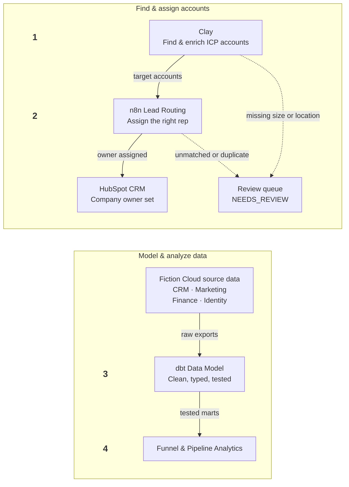
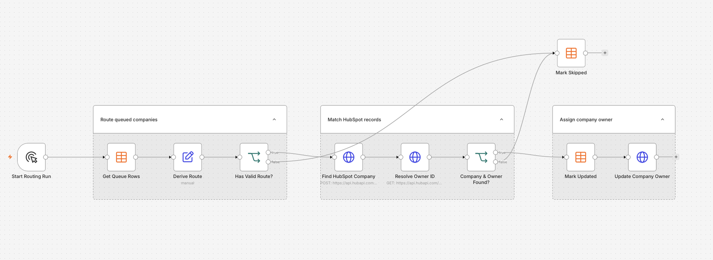

# Revenue Systems Engineering

**Data Engineering · GTM Automation · Analytics**

I design and build connected go-to-market systems that improve operational efficiency, data reliability, and revenue visibility.

My work combines data engineering, systems integration, workflow automation, and analytics to solve complex problems across Sales, Marketing, and Revenue Operations. From account discovery and lead routing to CRM data modeling and pipeline analytics, I focus on building scalable, reliable solutions that reduce manual work, improve decision-making, and enable revenue teams to operate more effectively.

---

## Meet Fiction Cloud

The projects below put this approach into practice for **Fiction Cloud**, a fictional B2B SaaS company that sells to mid-market and enterprise accounts in the US and UK.

Fiction Cloud's data spans the systems a real revenue team relies on:

- **CRM:** accounts, contacts, leads, opportunities with stage history, and owners
- **Marketing:** campaigns, touches, and the inquiries they generate
- **Finance:** billing customers, subscriptions, and monthly recognized revenue
- **Identity:** links that match CRM accounts to their finance records

Together, the projects form one connected lead-to-revenue system that:

- Gets the right accounts to the right reps
- Keeps the data trustworthy
- Gives Marketing, Sales, and Finance a single set of numbers they agree on

### Tech stack

- **Account discovery & enrichment:** Clay
- **Workflow automation:** n8n, HubSpot API
- **CRM:** HubSpot
- **Data modeling & testing:** dbt, DuckDB, SQL
- **Documentation:** Markdown, Mermaid diagrams

---

## How the projects connect

1. **Discover:** Clay finds and enriches ICP-fit accounts, labeling each with a segment, region, and fit decision. → [Write-up](clay_account_discovery.md)
2. **Route:** n8n assigns each account to the right rep and sets the Company owner in HubSpot. → [Write-up](lead_routing.md)
3. **Model:** dbt turns Fiction Cloud's CRM, marketing, finance, and identity data into clean, tested tables. → [Write-up](Data_Modeling.md)
4. **Analyze:** SQL against the dbt models answers the funnel and pipeline questions leaders ask every week. → [Write-up](funnel_analytics.md)

Bad data is stopped along the way: Clay and n8n send unclear or conflicting records to review instead of to a rep, and dbt tests catch problems before they reach a report.

> **Note:** The data model runs on Fiction Cloud's source data: CSV exports generated with Faker to mirror real CRM, marketing, and finance systems. It doesn't read from the HubSpot account that the routing workflow writes to. To regenerate the data yourself, see the [data generator setup](data_generator.md).

---

## Projects

### 1. Account Discovery & Enrichment

**Tools:** Clay

> Builds the target-account list: real companies that match the ICP, enriched and labeled for routing.

- **ICP-driven search.** US and UK searches filter on country, company size (200+ employees), industry, and domain, and enrichment runs only to fill in missing facts, so credits aren't spent re-fetching data.
- **Formula-based decisions.** Clay formulas derive segment, region, and fit status the same way for every row, using the exact codes the routing workflow expects.
- **Hiring as a buying signal.** Clay's Find jobs enrichment lifts accounts with open roles from `FIT` to `STRONG_FIT`.

**Result:** 73 candidate accounts sourced (50 US, 23 UK). Only `FIT` and `STRONG_FIT` accounts are exported; anything with a missing size or location is flagged `NEEDS_REVIEW` and never leaves Clay.

**Shows:** account discovery · data enrichment · ICP qualification · Clay formulas · data quality controls

**[Read the account discovery write-up →](clay_account_discovery.md)**

---

### 2. Lead Routing

**Tools:** n8n, HubSpot API

> Automatically assigns each target account to the right sales rep, and logs why.

- **Six sales lanes:** US East, US West, and UK, each split into Mid-Market and Enterprise, decided by company size and region.
- **Zero new HubSpot fields.** Built on HubSpot Free with its custom properties already used up: routing decisions live in an n8n Data Table, and only the native Company owner field is written back.
- **Safe to re-run and explainable.** Only undecided companies are picked up, so no account is assigned twice, and every decision records a status, reason, and policy version.

**Result:** Every company ends in one of two places: its owner is assigned in HubSpot, or it's skipped with a reason, such as an unmatched domain, a duplicate record, or a missing region.

**Shows:** workflow automation · API integration · routing design · data quality controls

**[Read the lead routing write-up →](lead_routing.md)**

---

### 3. Data Modeling

**Tools:** dbt, DuckDB, SQL

> Turns Fiction Cloud's raw CRM, marketing, finance, and identity data into a clean, typed, and tested model that analytics can trust.

- **One model across four systems.** 14 source tables are staged, joined, and built into marts, with identity links matching CRM accounts to their finance records.
- **HubSpot field types translated** into exact database types, e.g. Number → `DECIMAL`, Single checkbox → `BOOLEAN`.
- **History preserved.** Stage and field-change events let any past state be rebuilt, such as what a deal looked like at month-end.

**Result:** 29 dbt models built from 7,860 source rows, with 89 tests checking keys, missing values, and relationships on every build. The write-up walks through the core CRM tables, field types, and keys, with entity-relationship diagrams.

**Shows:** data modeling · dbt · SQL · data testing · CRM data structures

**[Read the data modeling write-up →](Data_Modeling.md)**

---

### 4. Sales Pipeline & Funnel Analytics

**Tools:** SQL, DuckDB, Mermaid charts

> Answers eight of the questions GTM leaders ask most, from first inquiry to recognized revenue.

- **6.1% of inquiries become closed-won deals.** The biggest drop is SQL → opportunity.
- **$1.2M vs. $940K April pipeline.** Sales' and Finance's numbers are reconciled down to the individual deals that separate them.
- **$360K bookings vs. $70K revenue in April.** Signed contract value isn't recognized revenue, and the analysis shows why.

**Result:** Eight leadership questions answered with short, readable SQL against the dbt models, each with real results, a chart, and a plain-English takeaway.

**Shows:** funnel analysis · pipeline reporting · metric definitions · cross-team reconciliation

**[Read the funnel & pipeline analytics →](funnel_analytics.md)**

---

## By the numbers

| | |
|---:|---|
| **73** | candidate accounts sourced in Clay across the US and UK |
| **14** | source tables across CRM, marketing, finance and identity |
| **7,860** | source rows modeled |
| **29** | dbt models: staging, intermediate and marts |
| **89** | automated data tests |
| **960** | marketing inquiries traced through the funnel |
| **240** | opportunities, with full stage history |
| **6** | sales routing lanes |
| **0** | new HubSpot fields required |

---

*Fiction Cloud and its CRM, marketing, and finance data are fictional. Clay searches return real public company data.*
