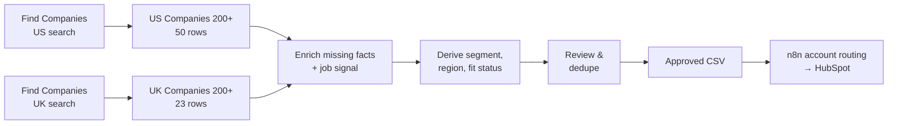
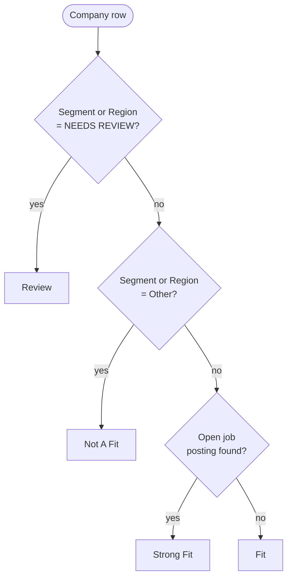

# Account Discovery & Enrichment in Clay

## The problem

Sales can't work accounts it hasn't found. The usual ways of building a target list both fall short:

- **Hand-built lists are slow and inconsistent.** Each rep pulls companies from a different source, and nobody records why a company made the cut.
- **Bought lists are fast but messy.** They're full of companies that are too small, in the wrong country, or missing the details needed to assign a rep.

## The solution

A Clay workbook that builds the target-account list for **Fiction Cloud**, a fictional B2B SaaS company:

1. **Find** real companies that match the ideal customer profile (ICP).
2. **Enrich** only the facts that are missing.
3. **Label** every company with a segment, a region, and a fit decision.

The reviewed list feeds the [account routing workflow](2_account_routing.md), which assigns each account to a rep in HubSpot.

## The ideal customer profile

Fiction Cloud sells to B2B operating companies with recurring work across teams, sites or service delivery. The ICP gives the search four rules:

| Dimension | Rule |
|---|---|
| **Company** | B2B operating organization with evidence of recurring cross-team, multi-site or service work |
| **Size** | 201 – 1,000 employees = Mid-Market; 1,001+ = Enterprise. 200 or fewer is out of scope. |
| **Geography** | United States or United Kingdom |
| **Priority industries** | Software, Logistics, Healthcare Operations, Business Services, Manufacturing. Search priorities, not automatic exclusions. |

## The Clay build


The workbook has one company search per country, each feeding its own company table:

| Search (source) | Company table | Rows | Columns |
|---|---|---:|---:|
| US mid-to-large software & healthcare companies | **US Companies 200+** | 50 | 25 |
| UK B2B companies, multiple industries | **UK Companies 200+** | 23 | 23 |

Enrichment runs at about **0.2 Clay credits per row**. Keeping the US and UK searches in separate tables means every row can be traced back to the search that produced it, and each country's filters can be tuned without disturbing the other.



## 1. Discovery: searching for ICP-fit companies

Each search uses Clay's **Find Companies** with filters that mirror the ICP:

| Filter | Set to | Why |
|---|---|---|
| **Location** | United States or United Kingdom, one search each | Country is a required ICP gate |
| **Company size** | Bands covering 201+ employees | Matches the Mid-Market floor; exact headcount is checked after import |
| **Industry** | Closest Clay labels for the priority industries | A starting point for the pilot, broadened later |
| **Domain** | Has a domain | Makes enrichment and CRM matching reliable |

Before importing, a sample of each search is previewed. If too many results are vendors, tiny firms or in the wrong country, the filters are tightened first. Clay joins different filters with AND and choices within one filter with OR, so each added keyword narrows the list.

## 2. Enrichment: paying only for missing facts

Clay search results are treated as candidate data, not facts. Enrichment is spent only where it adds something:

- **Skip what's already there.** If Find Companies already returned a credible size, location or website, no credits are spent re-fetching it.
- **Run conditionally.** Firmographic enrichments use Clay's *Only run if* setting, so they run only on rows with a missing or disputed value.
- **Pull the fields routing needs.** Employee count, headquarters country and state, industry and website.
- **Add a buying signal.** Clay's **Find jobs** enrichment looks for open job postings at each company. Hiring is a sign that a company is growing or changing, which makes it a better time to reach out.

## 3. Derived columns: turning raw data into decisions

Four formula columns turn the enriched data into the fields routing and prioritization need. Each is a short Clay formula, so the logic is visible in the table and anyone can audit it. All four follow the same conventions:

- **Every row gets an answer.** Each formula ends in a catch-all, so no row is left blank.
- **Unknown data is never guessed.** Missing or unrecognized data returns `NEEDS REVIEW` instead of a best guess. Clearly out-of-scope companies are filtered out earlier, by the company search itself.
- **Outputs feed the routing workflow directly.** The [account routing workflow](2_account_routing.md) reads the segment and region values as they are, so nothing has to be relabeled after export.

### Segment

Maps Clay's company size band to a sales segment:

```javascript
["201-500","501-1,000"].includes({{Size}}) ? "MID MARKET"
: ["1,001-5,000","5,001-10,000","10,000+","10,001+"].includes({{Size}}) ? "ENTERPRISE"
: "NEEDS REVIEW"
```

| Size band | Segment |
|---|---|
| 201 – 500, 501 – 1,000 | `MID MARKET` |
| 1,001 – 5,000, 5,001 – 10,000, 10,000+ / 10,001+ | `ENTERPRISE` |
| Blank or unrecognized band | `NEEDS REVIEW` |

There's no out-of-scope branch because the company search already filters to 200+ employees, so smaller companies never reach the table. These boundaries follow Clay's available size bands. The `Size` band is exported alongside the segment, so a borderline account can still be checked during review or reclassified if the policy changes.

### Region

The US and UK companies live in separate Clay tables, so each table sets its own region. In the **UK Companies 200+** table, Region is simply `UK`, because that search only returns UK companies.

In the **US Companies 200+** table, a formula maps the headquarters state to a US sales region:

```javascript
["AK","AZ","CA","CO","HI","ID","MT","NM","NV","OR","UT","WA","WY"]
    ?.includes({{Derived - State}}?.toUpperCase()) ? "US_WEST"
: ["AL","AR","CT","DC","DE","FL","GA","IL","IN","IA","KS","KY","LA","ME","MD","MA","MI",
   "MN","MS","MO","NE","NH","NJ","NY","NC","ND","OH","OK","PA","RI","SC","SD","TN","TX",
   "VT","VA","WV","WI"]
    ?.includes({{Derived - State}}?.toUpperCase()) ? "US_EAST"
: "NEEDS REVIEW"
```

| Headquarters state | Region |
|---|---|
| 13 western states: AK, AZ, CA, CO, HI, ID, MT, NM, NV, OR, UT, WA, WY | `US_WEST` |
| The other 37 states plus Washington, DC | `US_EAST` |
| Missing or unrecognized state | `NEEDS REVIEW` |

Together the two lists cover all 50 states and DC exactly once. The `?.` operators and `toUpperCase()` make the formula safe on blank values and lowercase codes, so a messy row is sent to review instead of breaking the column.

### Job Signal Found

Flags whether the Find jobs enrichment returned at least one open role:

```javascript
{{Find jobs}}?.jobs?.[0]?.job_title ? "YES" : "NO"
```

### Fit Status

Combines the three columns above into one decision per company:

```javascript
{{Region}}?.toLowerCase() === "needs review" || {{Segment}}?.toLowerCase() === "needs review" ? "Review"
: {{Region}}?.toLowerCase() === "other" || {{Segment}}?.toLowerCase() === "other" ? "Not A Fit"
: {{Job Signal Found}} === "YES" ? "Strong Fit"
: "Fit"
```



| Fit status | Meaning | What happens next |
|---|---|---|
| `Strong Fit` | Inside the ICP and actively hiring | Prioritized for outreach |
| `Fit` | Inside the ICP, no hiring signal yet | Routed to a rep as normal |
| `Review` | A required fact is missing or unclear | A person checks it before an owner is assigned |
| `Not A Fit` | Segment or region is outside the ICP | Kept in the table to explain the exclusion |

Missing data is checked first: a company with an unknown region or segment is never scored as a fit, because routing it would mean guessing which rep owns it. The comparisons are case-insensitive, so `NEEDS REVIEW` and `needs review` are treated the same.

## 4. Quality controls

- **Domain is the identity key.** Domains are normalized to lowercase with no URL path, so the same company found twice can be spotted and matched to HubSpot later.
- **Duplicates are reviewed, not auto-deleted.** Clay's auto-dedupe is left off on the raw tables, because a parent company and its subsidiary can share a domain. Possible duplicates are marked and resolved by a person, and the original rows are kept as evidence.
- **Raw tables are preserved.** `Review` and `Not A Fit` rows stay in the workbook, so every exclusion can be explained later.
- **Manual spot check before export.** At least 10 approved rows are checked by hand: headcount matches the segment, the state matches the region, and every source link opens.
- **Existing CRM accounts are flagged.** Companies already in HubSpot are marked for an update or an ownership review instead of being imported as new.

## 5. Handoff to routing

Companies leave Clay through an export view, downloaded as `fiction_cloud_icp_accounts_YYYY-MM-DD.csv` and imported into both HubSpot and the n8n routing queue. There, the [account routing workflow](2_account_routing.md) assigns each company to one of six sales lanes using its segment and region.

The export view can be filtered in two ways:

- **Approved companies only.** Filtering on `Fit` or `Strong Fit`, with no unresolved duplicates, keeps `Review` and `Not A Fit` companies in Clay, so routing only receives rows with a valid segment and region.
- **Approved and review companies.** Including review rows lets the routing workflow record them as `Skipped`, so every company in the batch has a visible outcome in the queue.

Either way, routing checks the region and segment on every row, so a company without a valid lane is marked `Skipped` rather than assigned.

The export columns use the same names as the routing queue:

| Export column | Used for |
|---|---|
| `Name`, `Domain` | Identity and HubSpot matching. Domain is normalized and is the unique key. |
| `Size`, `Segment` | Mid-Market vs. Enterprise lane |
| `Country`, `City`, `Derived_State`, `Region` | US East, US West, or UK lane |
| `Fit_Status`, `Job_Signal_Found` | Prioritizing outreach |
| `Description`, `Industry`, `Type` | Company context for the assigned rep |
| `Source_Account_ID`, `Record_Source` | Audit trail back to the Clay record |

## Design decisions

- **Separate searches per country.** Each table's source is unambiguous, and US and UK filters can evolve independently.
- **Enrich on demand, not by default.** Conditional enrichment keeps credit spend proportional to missing data rather than to row count.
- **Formulas over manual tagging.** Segment, region and fit are calculated the same way for every row, and the rules are readable in the table itself.
- **Review is a first-class outcome.** Missing or conflicting data produces `NEEDS REVIEW`, never a guessed region or segment, so routing downstream only ever sees clean inputs.
- **Shared codes across systems.** Clay outputs the same segment and region codes the routing workflow reads, so the handoff needs no translation step.
- **Signals are kept separate from fit.** Hiring activity raises a company from `Fit` to `Strong Fit` but never makes an out-of-profile company a fit.

## What's next

- **Add more buying signals.** Funding rounds, leadership changes and technology changes alongside job postings.
- **Score instead of tier.** Combine fit and signals into a numeric score that the [funnel analytics](4_funnel_analytics.md) can test against actual conversion.
- **Find contacts.** Add Clay's people search to find the right roles at each approved account, inheriting the account's owner.
- **Automate the handoff.** Send approved rows from Clay straight to the n8n routing queue instead of exporting a CSV.

*All companies in this pilot are treated as hypothetical target accounts. No revenue or product usage is implied.*
