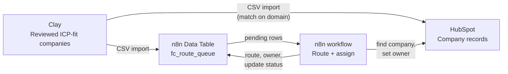
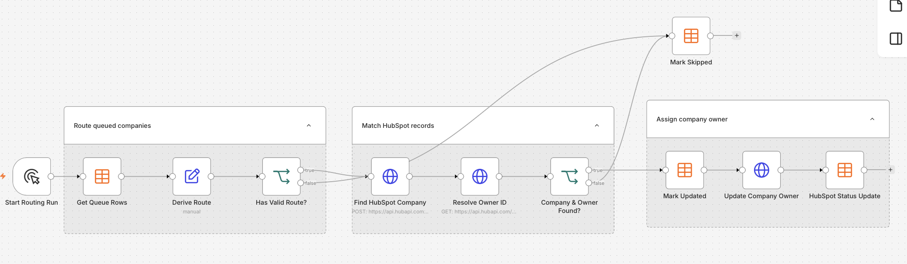
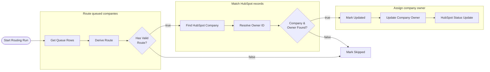

# Account Routing with Clay, n8n and HubSpot

## The problem

Every new target account needs an owner. When that decision is made by hand, it goes wrong in three ways:

- **It's slow.** The first rep to engage usually wins the conversation, so an account left unassigned costs pipeline.
- **It's inconsistent.** Two accounts with the same profile end up with different reps.
- **It can't be audited.** Nobody can say why an account went to the rep it did.

## The solution

An automated routing workflow for **Fiction Cloud**, a fictional B2B SaaS company:

1. **Clay** supplies a reviewed list of target companies.
2. **n8n** decides which sales lane each company belongs to.
3. **HubSpot** receives the owner assignment.

Every decision is logged in an n8n Data Table with its assigned route, owner, and update status, so any assignment can be traced later.

## Routing policy

Fiction Cloud sells to two segments in three regions, which gives six sales lanes. Each company is routed on two firmographic fields from Clay.

**Segment** comes from employee count:

| Employees | Segment |
|---|---|
| 201 – 1,000 | `MID MARKET` |
| 1,001+ | `ENTERPRISE` |

**Region** comes from headquarters location: the defined western US states map to `US_WEST`, the other 37 states and DC map to `US_EAST`, and Great Britain maps to `UK`.

Together they pick the lane:

| Region | MID MARKET | ENTERPRISE |
|---|---|---|
| **US_EAST** | `AE_EAST_MM` | `AE_EAST_ENT` |
| **US_WEST** | `AE_WEST_MM` | `AE_WEST_ENT` |
| **UK** | `AE_UK_MM` | `AE_UK_ENT` |

Anything that doesn't fit cleanly is marked **`Skipped`** for review instead of being guessed at: a missing region or segment, a missing or shared domain, a subsidiary, or conflicting firmographics. A wrong owner is worse than a short delay, because it sends a rep after an account that isn't theirs.

## Which system does what

Each tool has one job. Keeping them separate means each system holds only the data it's best at, and routing logic can change without touching the CRM's structure.

| System | Holds | Why |
|---|---|---|
| **Clay** | Account discovery, enrichment, ICP fit review, source evidence | Where accounts are found and checked before they reach the CRM |
| **HubSpot** | Company record: name, domain, employee count, country/state, owner | The system of record that reps work in |
| **n8n** | The routing workflow and a Data Table (`fc_route_queue`) that logs every decision | Where routing decisions are made and audited |

The same reviewed Clay batch seeds both HubSpot and the routing queue. HubSpot holds the records; n8n holds the decisions.

## Working within HubSpot Free

The portfolio runs on a HubSpot Free account, whose limit of 10 custom properties was already used up. Rather than overwrite unrelated standard fields, the design adds **zero new HubSpot properties**:

- Routing inputs use HubSpot's **default Company properties**: Company domain name, Number of employees, Country/Region code and State/Region code.
- Routing outputs (assigned route, owner email, and update status) live in the **n8n Data Table**, not in HubSpot.
- The only thing written back to HubSpot is the native **Company owner** field.

No paid HubSpot workflow tools are needed. The tradeoff is that the route lane is visible in n8n but can't be filtered on in HubSpot. If a custom property slot ever frees up, the lane would be the one field worth adding.

## The workflow

The workflow runs in three stages, each grouped in the n8n canvas. A successful company receives its owner in HubSpot before the queue sets `HubSpot_Update_Status` to `Updated`. Records that cannot be matched or routed are marked `Skipped` for review.

| Stage | Node | n8n node type | What it does |
|---|---|---|---|
| Trigger | **Start Routing Run** | Manual trigger | Starts a run on demand. Designed to move to a 15-minute schedule once tested. |
| Route queued companies | **Get Queue Rows** | Data Table | Loads the companies from the `fc_route_queue` Data Table. In this demo the Clay list is exported and imported into the Data Table rather than connected to Clay directly. |
| | **Derive Route** | Edit Fields (Set) | Combines region and segment into a route and owner, e.g. `US_WEST` + `ENTERPRISE` → `AE_WEST_ENT`. |
| | **Has Valid Route?** | If | Checks that the route is one of the six lanes. A company whose region or segment is marked for review in Clay fails the check and goes to **Mark Skipped**. |
| Match HubSpot records | **Find HubSpot Company** | HTTP Request (`POST` HubSpot CRM search) | Searches HubSpot Companies by domain to get the Company's Record ID. |
| | **Resolve Owner ID** | HTTP Request (`GET` HubSpot API) | Looks up the HubSpot owner ID to assign for the company's route bucket. |
| | **Company & Owner Found?** | If | Continues only if exactly one company and a valid owner were found. No match, or an ambiguous one, goes to **Mark Skipped**. |
| Assign company owner | **Mark Updated** | Data Table | Writes the assigned route and owner email to the queue row before the CRM write. It leaves `HubSpot_Update_Status` blank. |
| | **Update Company Owner** | HTTP Request (HubSpot API) | Sets the Company owner on the HubSpot record. The next step runs only after this request succeeds. |
| | **HubSpot Status Update** | Data Table | Sets `HubSpot_Update_Status` to `Updated` after HubSpot confirms the owner update. |
| Exception path | **Mark Skipped** | Data Table | Sets `HubSpot_Update_Status` to `Skipped`, so a person can fix the data and re-run the company. |

## The decision log

The `fc_route_queue` Data Table is the audit trail. It starts as the exported Clay file, one row per company, and the workflow fills in the last three columns:

| Column | Purpose |
|---|---|
| `Name`, `Domain`, `Description`, `Industry`, `Size`, `Type`, `City`, `Country` | Company details from Clay. Domain is the matching key. |
| `Source_Account_ID`, `Record_Source` | The Clay record ID and source system, so each row can be traced back to where it came from |
| `Segment`, `Region`, `Derived_State` | Routing inputs derived in Clay. A region that can't be determined is marked for review. |
| `Job_Signal_Found`, `Fit_Status` | ICP fit results from Clay |
| `n8n_assigned_route` | The lane the workflow assigned, e.g. `AE_EAST_MM` |
| `n8n_assigned_owner_email` | The email of the HubSpot owner assigned to the company |
| `HubSpot_Update_Status` | `Updated` once HubSpot confirms the owner change, or `Skipped` when routing stops. Blank means not yet processed. |
| `id`, `createdAt`, `updatedAt` | Row metadata added by n8n |

## Design decisions

- **Domain is the matching key.** Company names vary ("Acme" vs. "Acme, Inc."), but domains don't. Clay rows are deduplicated to one per normalized domain, and HubSpot's Company import deduplicates on domain too, so re-importing a company updates it instead of creating a duplicate.
- **Success is recorded only after HubSpot confirms.** `Updated` is written only after the owner update succeeds, so a failed CRM write never receives a false success status.
- **Bad data goes to review, not to a rep.** Missing fields, unmatched domains and duplicate CRM records are all stopped and marked `Skipped`, rather than routed on a guess.
- **Every decision is traceable.** The assigned route, owner email, and update status on each row answer "who owns this account, and did HubSpot get the change?" without anyone digging through execution logs.
- **The company is the routing unit.** Routing at the account level keeps every contact at one company with the same rep. Contacts can be added later and associated to the existing company by domain.

## Test plan

The workflow is tested against the cases most likely to break routing:

| Test case | Expected result |
|---|---|
| One company in each of the six region/segment lanes | Each gets the correct route and owner, status `Updated` |
| Company with a missing region | `Skipped`, never routed |
| Company whose region or segment is marked for review in Clay | `Skipped` |
| Company whose domain isn't in HubSpot | `Skipped`, no CRM match |
| HubSpot owner update fails | `Updated` is not written |

Evidence for each run: the exported Data Table CSV, the HubSpot Company records, and the n8n execution log.

> **Note:** The demo HubSpot account has a single user, so there is only one owner to assign. Live runs were therefore done one lane at a time, starting with `AE_EAST_MM`.

## What's next

- **Connect Clay directly.** Replace the manual export and import with a direct Clay-to-n8n connection.
- **Only pick up unprocessed rows.** Filter **Get Queue Rows** to rows with a blank `HubSpot_Update_Status`, so re-runs skip companies that are already done.
- **Move to a schedule.** Switch the manual trigger to a 15-minute schedule so new Clay accounts are routed without anyone starting a run.
- **Add capacity rules.** Balance assignments within a lane by each rep's current account count, not just by territory.
- **Route contacts and inbound leads.** Extend the same policy to contacts and form fills, inheriting the owner of the matched company.
- **Report on routing.** Feed the decision log into the [funnel analytics](4_funnel_analytics.md) so speed-to-assignment and review rates can be tracked over time.
