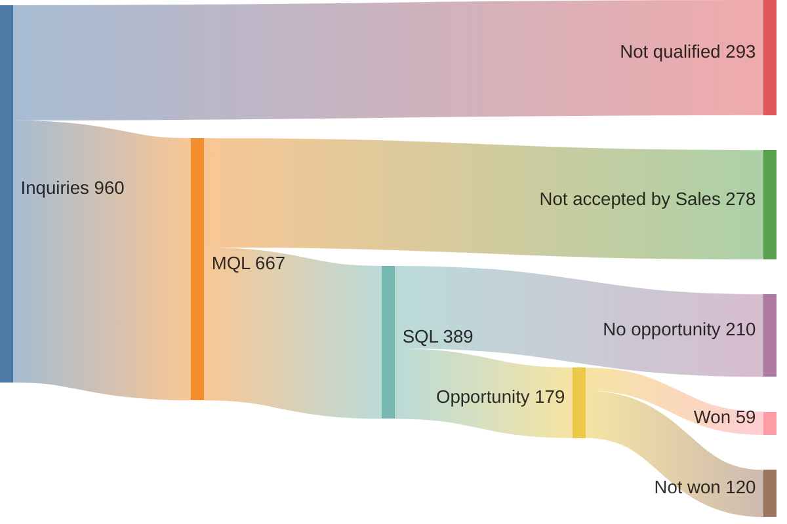
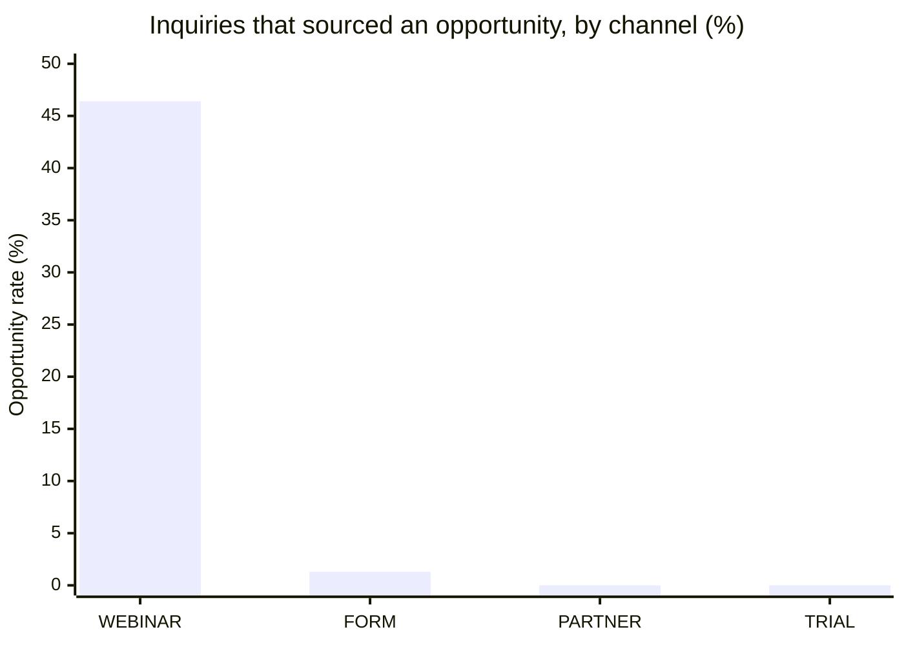
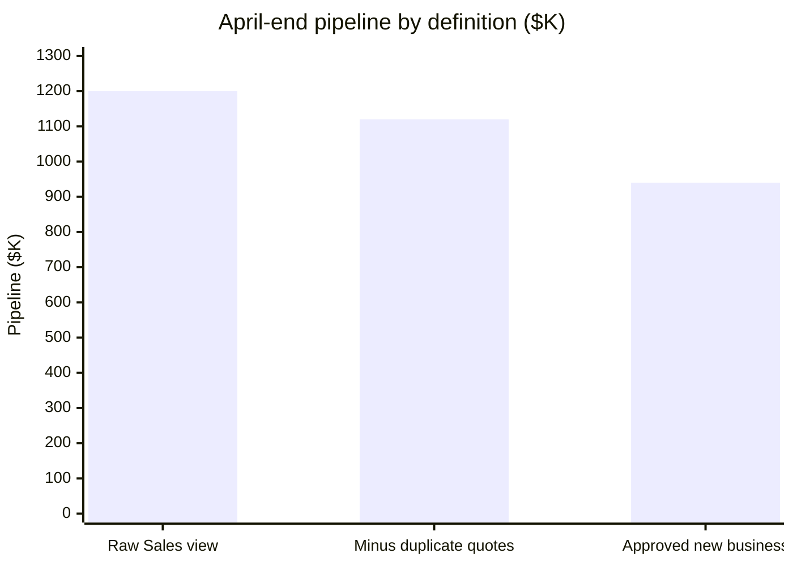
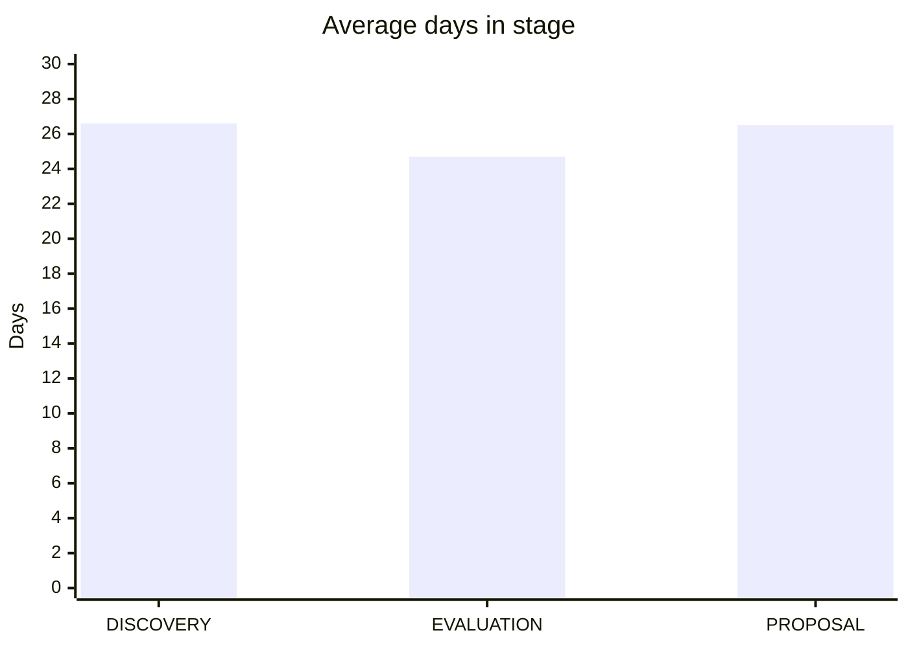
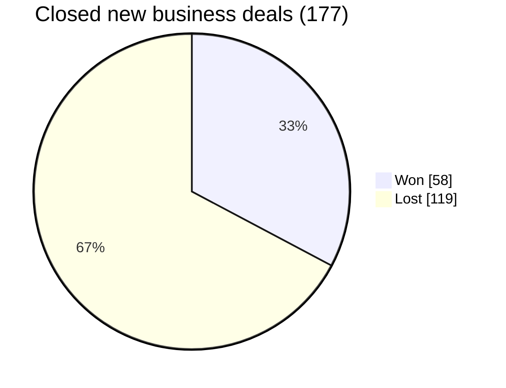
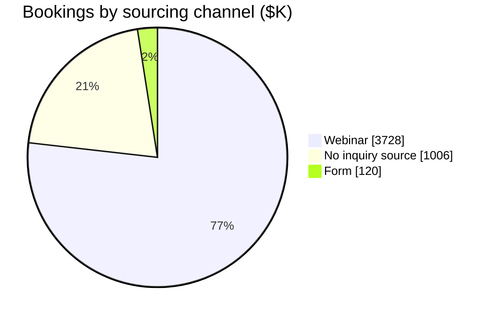
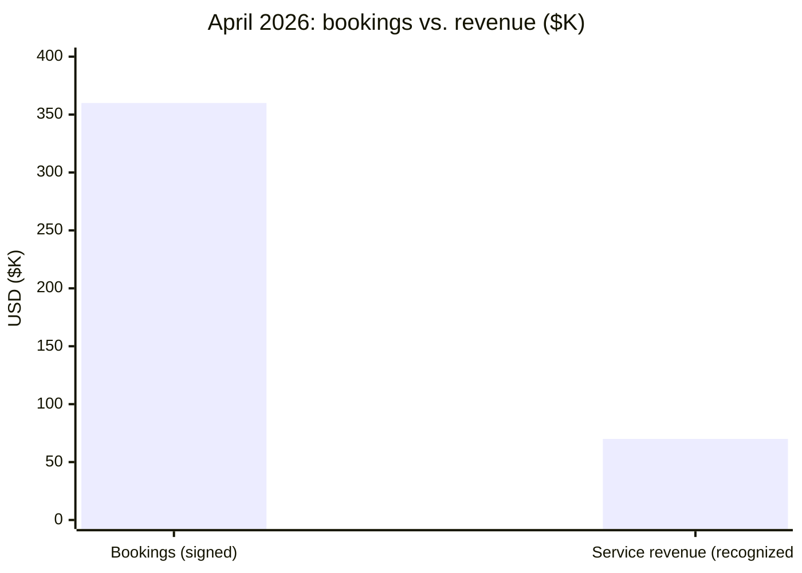

# Sales Pipeline & Funnel Analytics

## Why analytics matters to GTM teams

Marketing, Sales and Finance each run on their own system, and each one tells a slightly different story. Marketing counts leads, Sales counts pipeline, Finance counts revenue. Without a shared data layer, the weekly forecast call turns into an argument about whose number is right instead of a decision about what to do next.

Good GTM analytics fixes that. It connects the first form fill to the final invoice, so a team can see where deals come from, where they stall, and which investments turn into revenue. It also defines each metric once, so "pipeline" means the same thing in every meeting.

This page answers eight of the most common questions GTM leaders ask, using **Fiction Cloud**, a fictional B2B SaaS company whose lead-to-revenue data I modeled in DuckDB and dbt (see [Data Modeling](3_data_modeling.md) for the tables behind it). The data covers January 2025 to June 2026: 960 inquiries, 240 opportunities and the finance revenue they produced.

## The questions

| Area | Question |
|---|---|
| **Funnel** | 1. How many leads make it from inquiry to closed-won? |
| | 2. Which channel produces pipeline, not just leads? |
| **Pipeline** | 3. How much pipeline did we have at the end of April, and why do teams disagree? |
| | 4. How long do deals sit in each stage? |
| **Win rates** | 5. What's our win rate by deal type? |
| | 6. How long does it take to win a deal? |
| **Lead to revenue** | 7. Which channels turn into bookings and revenue? |
| | 8. Why are April bookings so much higher than April revenue? |

Where an existing dbt model already answers a question, I show the query against that model. Where it doesn't, I wrote a short query in dbt style. `{{ ref('model_name') }}` is how dbt refers to another model, so you can read it as a table name.

---

## Funnel

### 1. How many leads make it from inquiry to closed-won?

**Why it matters:** The funnel shows where volume is lost. A big drop between two stages points to the team or process to fix first.

`mart_inquiry_funnel` already has one row per inquiry, with its MQL and SQL dates and how many opportunities it sourced, so the query is just counting.

```sql
SELECT
    COUNT(*)                                            AS inquiries,
    COUNT(first_mql_at)                                 AS mqls,
    COUNT(first_sql_at)                                 AS sqls,
    COUNT(*) FILTER (sourced_opportunity_count > 0)     AS sourced_opp,
    COUNT(*) FILTER (won_sourced_opportunity_count > 0) AS won
FROM {{ ref('mart_inquiry_funnel') }}
```

| inquiries | mqls | sqls | sourced_opp | won |
|---:|---:|---:|---:|---:|
| 960 | 667 | 389 | 179 | 59 |



| Step | Conversion |
|---|---:|
| Inquiry → MQL | 69.5% |
| MQL → SQL | 58.3% |
| SQL → Opportunity | 46.0% |
| Opportunity → Won | 33.0% |
| **Inquiry → Won** | **6.1%** |

**Takeaway:** About 1 in 16 inquiries becomes a closed-won deal. The biggest single drop is SQL to opportunity: Sales accepts 389 leads but opens deals on fewer than half of them, so that handoff is the first place to look.

**Counting people vs. inquiries:** One person can submit several inquiries, so the funnel changes depending on what you count. The same mart answers the approved April view from the existing model:

```sql
SELECT
    COUNT(*)                           AS inquiries,
    COUNT(DISTINCT contact_id)         AS people,
    COUNT(*) FILTER (reached_sql_by_cutoff) AS sqls,
    SUM(sourced_opportunity_count)     AS sourced_opps,
    SUM(won_sourced_opportunity_count) AS won_opps
FROM {{ ref('mart_inquiry_funnel') }}
WHERE is_april_mql_cohort
```

| inquiries | people | sqls | sourced_opps | won_opps |
|---:|---:|---:|---:|---:|
| 24 | 20 | 6 | 3 | 1 |

Marketing reports 24 April MQLs and Sales sees 20 people. Both are right; they're counting different things. Putting both numbers side by side ends the argument.

### 2. Which channel produces pipeline, not just leads?

**Why it matters:** Marketing budgets are often judged on lead volume. A channel can produce plenty of MQLs and still never create a deal.

```sql
SELECT
    channel,
    COUNT(*)                                           AS inquiries,
    ROUND(100.0 * COUNT(first_mql_at) / COUNT(*), 1)   AS mql_rate_pct,
    ROUND(100.0 * COUNT(first_sql_at) / COUNT(*), 1)   AS sql_rate_pct,
    COUNT(*) FILTER (sourced_opportunity_count > 0)    AS sourced_opp,
    ROUND(100.0 * COUNT(*) FILTER (sourced_opportunity_count > 0) / COUNT(*), 1) AS opp_rate_pct
FROM {{ ref('mart_inquiry_funnel') }}
GROUP BY channel
ORDER BY opp_rate_pct DESC
```

| channel | inquiries | mql_rate_pct | sql_rate_pct | sourced_opp | opp_rate_pct |
|---|---:|---:|---:|---:|---:|
| WEBINAR | 379 | 81.8 | 64.1 | 176 | 46.4 |
| FORM | 225 | 64.0 | 23.6 | 3 | 1.3 |
| PARTNER | 183 | 62.8 | 27.3 | 0 | 0.0 |
| TRIAL | 173 | 56.6 | 24.9 | 0 | 0.0 |



**Takeaway:** Every channel qualifies more than half of its inquiries as MQLs, so on a lead-volume dashboard they all look healthy. But webinars produced 176 of the 179 opportunities. Partner and trial inquiries produced none. Judged by MQLs alone, the budget would be spread evenly; judged by pipeline, webinars are carrying the business.

---

## Pipeline

### 3. How much pipeline did we have at the end of April, and why do teams disagree?

**Why it matters:** Pipeline is the main input to the forecast. If Sales and Finance start from different numbers, the forecast is wrong before anyone touches it.

`mart_pipeline_as_of` already does the work. It rebuilds each deal's stage as of April 30 from the stage history, then applies three nested definitions, each narrower than the last. This is the core of the existing model:

```sql
-- Sales' raw view: target segment and open at April end
CASE
    WHEN region = 'US_EAST'
        AND segment = 'MID_MARKET'
        AND stage_apr_30 IN ('DISCOVERY', 'EVALUATION', 'PROPOSAL', 'NEGOTIATION')
    THEN TRUE ELSE FALSE
END AS in_raw_sales_pipeline,

-- Valid pipeline: raw scope minus duplicate quote records
in_raw_sales_pipeline AND is_quote_survivor AS in_valid_all_type_pipeline,

-- Approved pipeline: valid scope limited to new business
in_valid_all_type_pipeline AND opportunity_type = 'NEW_BUSINESS' AS in_new_business_pipeline
```

Summing each flag gives the three numbers:

```sql
SELECT
    COUNT(*) FILTER (in_raw_sales_pipeline)             AS raw_opps,
    SUM(amount_usd) FILTER (in_raw_sales_pipeline)      AS raw_usd,
    COUNT(*) FILTER (in_valid_all_type_pipeline)        AS valid_opps,
    SUM(amount_usd) FILTER (in_valid_all_type_pipeline) AS valid_usd,
    COUNT(*) FILTER (in_new_business_pipeline)          AS approved_opps,
    SUM(amount_usd) FILTER (in_new_business_pipeline)   AS approved_usd
FROM {{ ref('mart_pipeline_as_of') }}
```

| Definition | Opps | Pipeline |
|---|---:|---:|
| Raw Sales view | 11 | $1,200,000 |
| Minus duplicate quotes | 10 | $1,120,000 |
| Approved: new business only | 8 | $940,000 |



**Takeaway:** Sales says $1.2M and Finance says $940K, and both are using real data. The $260K gap is one duplicate quote ($80K) and non-new-business deals ($180K). Because the mart keeps every row and tags the reason each deal is in or out, the gap can be traced to specific records instead of argued about.

### 4. How long do deals sit in each stage?

**Why it matters:** Time in stage shows where deals stall. It's also an early warning sign: a deal that has been in one stage far longer than average is at risk.

No existing model answers this, so this query uses the stage history directly. `LEAD()` looks at the next event for the same deal, which gives the date each stage ended.

```sql
-- One row per stage a deal entered, with when it entered and left
WITH stage_entries AS (
    SELECT
        opp_id,
        to_stage_normalized AS stage,
        occurred_at AS entered_at,
        LEAD(occurred_at) OVER (PARTITION BY opp_id ORDER BY occurred_at) AS exited_at
    FROM {{ ref('stg_crm_opportunity_stage_events') }}
)

-- Average days in each open stage, counting only stages the deal has left
SELECT
    stage,
    COUNT(*) AS opps,
    ROUND(AVG(DATE_DIFF('day', entered_at, exited_at)), 1) AS avg_days_in_stage
FROM stage_entries
WHERE exited_at IS NOT NULL
    AND stage IN ('DISCOVERY', 'EVALUATION', 'PROPOSAL', 'NEGOTIATION')
GROUP BY stage
```

| stage | opps | avg_days_in_stage |
|---|---:|---:|
| DISCOVERY | 240 | 26.6 |
| EVALUATION | 202 | 24.7 |
| PROPOSAL | 218 | 26.5 |



**Takeaway:** Deals spend about 25 days in each stage, so no single stage is a bottleneck. A deal sitting in Proposal for 50+ days is roughly twice the norm and worth a review. Fiction Cloud's data never uses the Negotiation stage, which is why it doesn't appear.

---

## Win Rates

### 5. What's our win rate by deal type?

**Why it matters:** Win rate turns pipeline into a forecast. If new business wins a third of its deals, $940K of pipeline is worth roughly $310K in expected bookings.

```sql
SELECT
    opportunity_type,
    COUNT(*) FILTER (stage_normalized = 'CLOSED_WON')  AS won,
    COUNT(*) FILTER (stage_normalized = 'CLOSED_LOST') AS lost,
    ROUND(100.0 * COUNT(*) FILTER (stage_normalized = 'CLOSED_WON')
        / COUNT(*) FILTER (stage_normalized IN ('CLOSED_WON', 'CLOSED_LOST')), 1) AS win_rate_pct
FROM {{ ref('fct_opportunity') }}
GROUP BY opportunity_type
ORDER BY win_rate_pct DESC
```

| opportunity_type | won | lost | win_rate_pct |
|---|---:|---:|---:|
| NEW_BUSINESS | 58 | 119 | 32.8 |
| EXPANSION | 13 | 27 | 32.5 |
| RENEWAL | 0 | 2 | 0.0 |



**Takeaway:** New business and expansion both win about 1 in 3 closed deals. The denominator is closed deals only (won + lost), because open deals haven't had a chance to win yet; including them would understate the rate. Renewal has only 2 deals, too few to draw a conclusion from.

### 6. How long does it take to win a deal?

**Why it matters:** Sales cycle length tells you how far ahead pipeline has to be built. If deals take 74 days to close, a deal created in May won't book until about August.

The win date comes from the existing `mart_bookings` model, which dates each win from the stage history.

```sql
-- Won deals only: created date from the opp, win date from mart_bookings
WITH won AS (
    SELECT
        bookings.opp_id,
        bookings.opportunity_type,
        DATE_DIFF('day', opps.created_at, bookings.booking_at) AS cycle_days
    FROM {{ ref('mart_bookings') }} AS bookings
    INNER JOIN {{ ref('fct_opportunity') }} AS opps
        ON bookings.opp_id = opps.opp_id
)

SELECT
    opportunity_type,
    COUNT(*) AS won_deals,
    ROUND(AVG(cycle_days), 0) AS avg_cycle_days,
    MEDIAN(cycle_days) AS median_cycle_days
FROM won
GROUP BY opportunity_type
```

| opportunity_type | won_deals | avg_cycle_days | median_cycle_days |
|---|---:|---:|---:|
| NEW_BUSINESS | 58 | 74 | 73 |
| EXPANSION | 13 | 74 | 71 |

**Takeaway:** A won deal takes about 10 weeks from creation to close, for both new business and expansion. The average and median are almost equal, so a few very long deals aren't skewing the number. For planning, pipeline created this month mostly lands as bookings about two and a half months from now.

---

## Lead to Revenue

### 7. Which channels turn into bookings and revenue?

**Why it matters:** This is the question marketing leaders most want answered and most often can't. It requires joining marketing, CRM and finance data, which is exactly what the lead-to-revenue mart was built for.

`mart_lead_to_revenue` already has one row per opportunity with its sourcing inquiry, booking and finance revenue. Joining it to the inquiry funnel adds the channel.

```sql
-- Each opp's sourcing channel, through its primary sourced inquiry
WITH opp_channel AS (
    SELECT
        l2r.opp_id,
        COALESCE(funnel.channel, 'NO_INQUIRY_SOURCE') AS channel,
        l2r.booked_amount_usd,
        l2r.service_revenue_to_date_usd
    FROM {{ ref('mart_lead_to_revenue') }} AS l2r
    LEFT JOIN {{ ref('mart_inquiry_funnel') }} AS funnel
        ON l2r.primary_sourced_inquiry_id = funnel.inquiry_id
)

SELECT
    channel,
    COUNT(*) AS opps,
    COUNT(*) FILTER (booked_amount_usd > 0) AS won_opps,
    SUM(booked_amount_usd) AS booked_usd,
    SUM(service_revenue_to_date_usd) AS revenue_to_date_usd
FROM opp_channel
GROUP BY channel
ORDER BY booked_usd DESC
```

| channel | opps | won_opps | booked_usd | revenue_to_date_usd |
|---|---:|---:|---:|---:|
| WEBINAR | 176 | 58 | $3,728,000 | $524,800 |
| NO_INQUIRY_SOURCE | 61 | 12 | $1,006,000 | $60,000 |
| FORM | 3 | 1 | $120,000 | $0 |



**Takeaway:** Webinars sourced 77% of all bookings ($3.7M of $4.85M) and nearly all revenue to date. The second-largest slice, $1.0M, has no inquiry behind it at all. Those are deals Sales created directly, such as outbound or expansion. Showing that slice honestly matters: forcing it onto a marketing channel would overstate marketing's impact.

### 8. Why are April bookings so much higher than April revenue?

**Why it matters:** Sales celebrates bookings and Finance reports revenue, and the two are rarely the same number. Leaders need to know why, or the gap looks like an error.

Both numbers come straight from existing models: `mart_bookings` for signed deals and `fct_monthly_service_revenue` for revenue Finance recognized.

```sql
-- April bookings in the approved scope: signed contract value
WITH april_bookings AS (
    SELECT COUNT(*) AS deals, SUM(booked_amount_usd) AS booked_usd
    FROM {{ ref('mart_bookings') }}
    WHERE booking_month = DATE '2026-04-01'
        AND region = 'US_EAST' AND segment = 'MID_MARKET'
        AND opportunity_type = 'NEW_BUSINESS' AND is_quote_survivor
),

-- April service revenue for the same region and segment: what Finance recognized
april_revenue AS (
    SELECT SUM(service_revenue_usd) AS revenue_usd
    FROM {{ ref('fct_monthly_service_revenue') }}
    WHERE service_month = DATE '2026-04-01'
        AND region = 'US_EAST' AND segment = 'MID_MARKET'
)

SELECT april_bookings.deals, april_bookings.booked_usd, april_revenue.revenue_usd
FROM april_bookings
CROSS JOIN april_revenue
```

| deals | booked_usd | revenue_usd |
|---:|---:|---:|
| 3 | $360,000 | $70,000 |



**Takeaway:** Neither number is wrong; they measure different things. A booking is the full contract value on the day it's signed. Revenue is recognized month by month as the service is delivered. Three deals signed in April for $360K, yet none of April's $70K came from them. It all came from contracts that were already running. The $360K will show up as revenue month by month once those new contracts start.

---

## Notes on the data

- **Fictional data:** Fiction Cloud and every company and person in it are made up. The patterns are realistic, but some are exaggerated to make a point, such as webinars sourcing almost every opportunity.
- **History, not current state:** Questions 3, 4 and 6 use the stage history tables rather than each deal's current stage. That's what makes "pipeline at the end of April" answerable after April is over.
- **What isn't here:** The data has no sales activity (calls, emails, meetings) and no lost reasons, so questions like "why do we lose?" or "how many touches does a deal need?" are out of scope.
