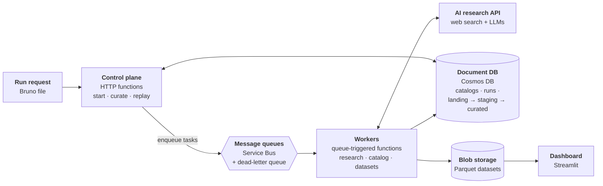
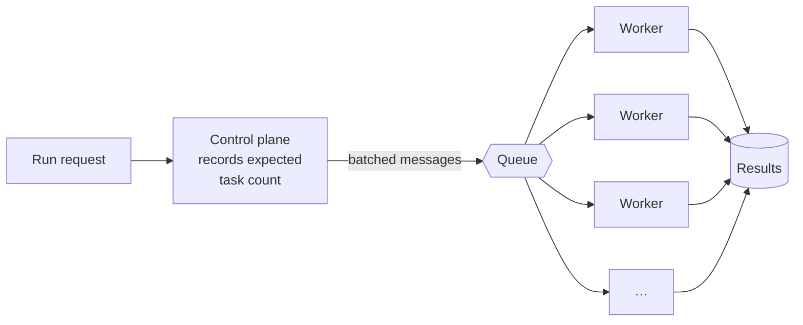
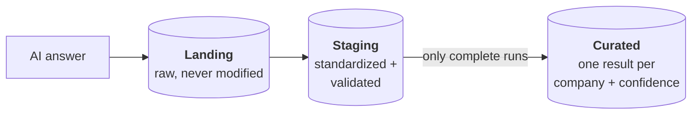

# AI Research Engine: System Architecture

The architecture behind the [AI Research Engine](5_ai_research_engine.md), which I designed and built end to end on Azure. It turns one research request into thousands of AI web-research tasks, and stays correct, affordable and auditable when every task depends on a slow, billed and sometimes unreliable AI service.

## At a glance

| | |
|---|---|
| **What it does** | Researches a list of companies with several AI models and turns their answers into scored, evidence-backed judgments |
| **Scale** | One request becomes companies × models tasks, processed in parallel |
| **Reliability** | Five types of failure, each with its own response |
| **Auditability** | Every AI answer is stored exactly as received, before any processing |
| **Change** | A new research question needs a new rubric, not new code |
| **Quality** | 56 unit tests, plus integration test collections replayed after changes |
| **Stack** | Azure Functions · Service Bus · Cosmos DB · Blob Storage · Perplexity · OpenAI · Pydantic · Bruno · Streamlit |

---

## 1 · Scale: one request, thousands of tasks

**The problem:** 300 companies × 3 models × 4 rubrics is 3,600 AI calls, and a single deep-research call can take several minutes.

| How | Why it matters |
|---|---|
| The control plane enqueues work and returns immediately | Nothing waits on a multi-minute AI call |
| One message per company per model | Tasks run in parallel; one slow or failed task holds up nothing |
| Expected task count recorded up front | The system always knows whether a run is complete |

**The result:** run time is set by worker concurrency and API rate limits, not by working through the list one company at a time.

---

## 2 · Reliability: AI fails in five ways

**The problem:** retrying everything wastes money; giving up early loses work. Each failure needs a different response.

| | Failure | Example | Response |
|---|---|---|---|
| ⏱ | **Transient** | Rate limit, timeout, server error | Retry with exponential backoff, honoring the provider's retry-after hint |
| 📭 | **Infrastructure** | Dropped connection | Dead-letter queue, then replay filtered by run |
| ⚠️ | **Unusable** | Answer given without a web search; empty answer | Limited retries, then **accept and flag** |
| 🔧 | **Malformed** | Invalid JSON, or JSON that doesn't match the rubric | Three-step repair: parse → validate → reformat with a second LLM |
| ⛔ | **Permanent** | Invalid request or configuration | Rejected before any work is enqueued |

**Built for long calls:** client timeouts cover deep research end to end, and queue message locks renew for up to 30 minutes so a slow task is never handed to a second worker.

---

## 3 · Cost: never pay twice

**The problem:** every AI call is billed, including the ones that fail.

| Mechanism | What it prevents |
|---|---|
| **Rerun-safe IDs** (run + company + model) | A replayed task creating a duplicate result that gets double-counted |
| **Replay filtered by run** | Fixing one run reprocessing another |
| **Accept and flag** | Paying again and again for answers that are complete but unusable |
| **One retry layer, not three** | SDK, backoff loop and queue retries multiplying each other |
| **Batch API path** | Paying full price on large classification jobs |
| **Separate test environment** | Trial runs polluting production results |

---

## 4 · Trust: keep the evidence

**The problem:** a judgment is only useful if its evidence can be inspected, and a processing bug must never destroy that evidence.

| Safeguard | What it does |
|---|---|
| **Layered storage** | Staging and curated can be rebuilt from landing without paying for the research again |
| **Completeness gate** | Curation refuses to run until every expected task has landed, and reports what's missing |
| **Rerun-safety gate** | Existing curated results are never overwritten unless that's explicitly requested |
| **Computed scores** | The AI picks a label; the system looks up its score, so the two can't contradict each other |
| **Grounding flag** | Answers given without a web search are marked, not silently trusted |

---

## 5 · Change: new research, no new code

**The problem:** research questions change weekly; deployments shouldn't.

| To… | You… | Code change? |
|---|---|---|
| Ask a new research question | Register a new rubric schema | Schema only |
| Add or swap an AI model | List it in the run request | None |
| Try a new consensus method | Add a strategy class to the registry | One class |
| Retire a rubric | Mark it deprecated; it's never deleted | None. Old runs stay reproducible |
| Research a new set of companies | Build or subset a catalog | None |

---

## Architecture decisions

| Decision | Instead of | Why |
|---|---|---|
| Queue-based fan-out | Workflow orchestration | Independent tasks need per-task retries and replay, not shared orchestration state |
| Document database | Relational database | Result shape varies by rubric and AI provider |
| Landing → staging → curated | Storing only the final answer | Evidence survives processing bugs |
| Research and classify in one AI call | Separate research and classification calls | One fewer call per task; the label stays tied to the evidence the model found |
| Three models with consensus | One stronger model | Agreement gives a confidence signal; an odd number avoids tied votes |
| Run requests as files in git | An admin UI | Every run is reviewable, diffable and reproducible |
| Serverless compute | Containers or VMs | Idle most days, thousands of tasks during a run |

## How it evolved

| | Period | What changed |
|---|---|---|
| **1** | 2025 | Proved the idea: synchronous search, plus parallel tournament-style ranking |
| **2** | Mid-2025 to early 2026 | Queue workers, landing and staging layers, batch classification, dashboard datasets |
| **3** | 2026 | Single-call structured research, schema registry, multi-model consensus, failure taxonomy and replay |

## What's next

| Next step | Why |
|---|---|
| **Event-driven curation** | Start curation automatically when a run completes |
| **Run status view** | One place to see progress, failures and dead-lettered tasks |
| **Infrastructure as code** | Recreate environments on demand |
| **Private-company catalogs** | Research accounts from tools like Clay that public market data doesn't cover |
| **Cost per run** | Make AI spend a first-class metric next to quality |
