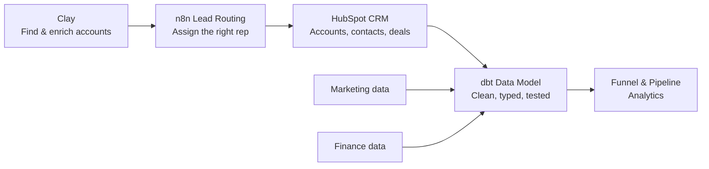

# GTM Engineering Portfolio

**Lead-to-revenue systems for a B2B SaaS company: from account discovery and routing, to a tested CRM data model, to the analytics leaders use to run the business.**

Every project here is built on **Fiction Cloud**, a fictional B2B SaaS company with realistic CRM, marketing and finance data. The goal is the same one a GTM engineer has on the job: get the right accounts to the right reps, make the data trustworthy, and give Marketing, Sales and Finance a single set of numbers they agree on.

| Built with | |
|---|---|
| **Data** | DuckDB, dbt, SQL |
| **Automation** | n8n, HubSpot API, Clay |
| **Docs** | Markdown, Mermaid diagrams |

---

## How the pieces fit

Accounts are found in Clay and routed to an owner in HubSpot. CRM, marketing and finance data are then modeled in dbt, and the analytics layer answers the questions GTM leaders ask every week.

---

## Projects

### 1. Account Discovery & Enrichment in Clay

> Builds the target-account list: real companies that match the ICP, enriched and labeled for routing.

Two Clay company searches, one for the US and one for the UK, feed company tables where every account is enriched, segmented, given a region and assigned a fit decision.

- **ICP-driven search.** Filters on country, company size (200+ employees), industry and domain mirror the ideal customer profile.
- **Credits spent only where needed.** Enrichment runs conditionally, filling in missing facts instead of re-fetching what the search already returned.
- **Formula-based decisions.** Clay formulas derive segment, region and fit status the same way for every row, using the exact codes the routing workflow expects.
- **Hiring as a buying signal.** Clay's Find jobs enrichment lifts accounts with open roles from `FIT` to `STRONG_FIT`.
- **Unclear data goes to review, not to the CRM.** Missing sizes or locations are flagged `NEEDS_REVIEW` rather than guessed.

**Shows:** account discovery · data enrichment · ICP qualification · Clay formulas · data quality controls

**[Read the account discovery write-up →](clay_account_discovery.md)**

---

### 2. Lead Routing: Clay → n8n → HubSpot

> Automatically assigns each target account to the right sales rep, and logs why.

An n8n workflow reads companies enriched in Clay, decides which of six sales lanes each belongs to based on company size and region, finds the matching HubSpot record, and sets the Company owner.

- **Six sales lanes**: US East, US West and UK, each split into Mid-Market and Enterprise.
- **Zero new HubSpot fields.** Built on HubSpot Free with its custom properties already used up: routing decisions live in an n8n Data Table, and only the native owner field is written back.
- **Bad data goes to review, not to a rep.** Missing regions, unmatched domains and duplicate records are stopped and labeled.
- **Safe to re-run.** Only undecided companies are picked up, so no account is ever assigned twice.
- **Every assignment is explainable**, with a status, reason and policy version on each decision.

**Shows:** workflow automation · API integration · routing design · data quality controls

**[Read the lead routing write-up →](lead_routing.md)**

---

### 3. CRM Data Modeling

> Turns raw CRM exports into a clean, typed and tested data model that analytics can trust.

A walkthrough of how CRM data is modeled for analytics: the core tables, how HubSpot field types map to database types, and how keys connect everything.

- **Core CRM objects mapped**: accounts, contacts, leads (inquiries), opportunities, opportunity history and owners.
- **HubSpot field types translated** into exact database types, e.g. Number → `DECIMAL`, Single checkbox → `BOOLEAN`.
- **Primary and foreign keys defined and tested.** dbt tests check uniqueness, missing values and relationships on every build; 89 tests across the project.
- **History preserved.** Stage and field-change events let any past state be rebuilt, such as what a deal looked like at month-end.
- **Entity-relationship diagrams** of the full schema.

**Shows:** data modeling · dbt · SQL · data testing · CRM data structures

**[Read the data modeling write-up →](Data_Modeling.md)**

---

### 4. Sales Pipeline & Funnel Analytics

> Answers eight of the questions GTM leaders ask most, from first inquiry to recognized revenue.

Short, readable SQL against the dbt models, each with real results, a chart and a plain-English takeaway.

| Headline finding | |
|---|---|
| **6.1%** | of inquiries become closed-won deals. The biggest drop is SQL → opportunity. |
| **176 of 179** | opportunities were sourced by webinars. Other channels produced MQLs, but no pipeline. |
| **$1.2M vs. $940K** | Sales' and Finance's April pipeline, reconciled down to the individual deals that separate them. |
| **~33%** | win rate on closed new business and expansion deals, with a ~74-day sales cycle. |
| **$360K vs. $70K** | April bookings vs. April revenue, explained: signed contract value isn't recognized revenue. |

**Shows:** funnel analysis · pipeline reporting · metric definitions · cross-team reconciliation

**[Read the funnel & pipeline analytics →](funnel_analytics.md)**

---

## By the numbers

| | |
|---:|---|
| **73** | candidate accounts sourced in Clay across the US and UK |
| **14** | source tables across CRM, marketing, finance and identity |
| **7,860** | source rows modeled |
| **29** | dbt models: staging, intermediate and marts |
| **89** | automated data tests |
| **960** | marketing inquiries traced through the funnel |
| **240** | opportunities, with full stage history |
| **6** | sales routing lanes |
| **0** | new HubSpot fields required |

---

*All companies, people and figures in Fiction Cloud are fictional.*
