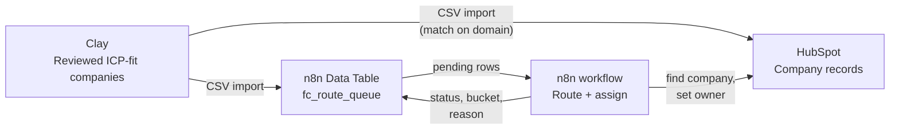
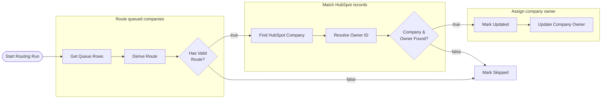

# Lead Routing with Clay, n8n and HubSpot

## The problem

When a new target account lands in the CRM, someone has to decide which rep owns it. Done by hand, that decision is slow, inconsistent and hard to audit: two accounts with the same profile end up with different reps, and nobody can say why. Slow routing costs pipeline too, because the first rep to engage usually wins the conversation.

This project automates that decision for **Fiction Cloud**, a fictional B2B SaaS company. Clay produces a reviewed list of target companies, n8n decides which sales lane each one belongs to, and HubSpot receives the owner assignment. Every decision is logged with a reason, so any assignment can be explained after the fact.

## Routing policy

Fiction Cloud sells to two segments in three regions, which gives six sales lanes. Each company is routed on two firmographic fields from Clay.

**Segment** comes from employee count:

| Employees | Segment |
|---|---|
| 200 – 999 | `MID_MARKET` |
| 1,000+ | `ENTERPRISE` |

**Region** comes from headquarters location: the defined western US states map to `US_WEST`, all other US states and DC map to `US_EAST`, and Great Britain maps to `UK`.

Together they pick the lane:

| Region | MID_MARKET | ENTERPRISE |
|---|---|---|
| **US_EAST** | `AE_EAST_MM` | `AE_EAST_ENT` |
| **US_WEST** | `AE_WEST_MM` | `AE_WEST_ENT` |
| **UK** | `AE_UK_MM` | `AE_UK_ENT` |

Anything that doesn't fit cleanly goes to **REVIEW** instead of being guessed at: a missing region or segment, a missing or shared domain, a subsidiary, or conflicting firmographics. A wrong owner is worse than a short delay, because it sends a rep after an account that isn't theirs.

## Which system does what

Each tool has one job. Keeping them separate means each system holds only the data it's best at, and routing logic can change without touching the CRM's structure.

| System | Holds | Why |
|---|---|---|
| **Clay** | Account discovery, enrichment, ICP fit review, source evidence | Where accounts are found and checked before they reach the CRM |
| **HubSpot** | Company record: name, domain, employee count, country/state, owner | The system of record that reps work in |
| **n8n** | The routing workflow and a Data Table (`fc_route_queue`) that logs every decision | Where routing decisions are made and audited |

The same reviewed Clay batch seeds both HubSpot and the routing queue. HubSpot holds the records; n8n holds the decisions.

## Working within HubSpot Free

The portfolio runs on a HubSpot Free account, whose limit of 10 custom properties was already used up. Rather than overwrite unrelated standard fields, the design adds **zero new HubSpot properties**:

- Routing inputs use HubSpot's **default Company properties**: Company domain name, Number of employees, Country/Region code and State/Region code.
- Routing outputs (region, segment, lane, status, reason) live in the **n8n Data Table**, not in HubSpot.
- The only thing written back to HubSpot is the native **Company owner** field.

No paid HubSpot workflow tools are needed. The tradeoff is that the route lane is visible in n8n but can't be filtered on in HubSpot. If a custom property slot ever frees up, the lane would be the one field worth adding.

## The workflow

The workflow runs in three stages, each grouped in the n8n canvas. Every company ends in one of two places: its owner is assigned in HubSpot, or it's marked skipped with a reason.

| Stage | Node | n8n node type | What it does |
|---|---|---|---|
| Trigger | **Start Routing Run** | Manual trigger | Starts a run on demand. Designed to move to a 15-minute schedule once tested. |
| Route queued companies | **Get Queue Rows** | Data Table | Reads queue rows with a blank `route_status`, i.e. companies not yet decided. Already-routed rows are never picked up again. |
| | **Derive Route** | Edit Fields (Set) | Combines region and segment into a route bucket, e.g. `US_WEST` + `ENTERPRISE` → `AE_WEST_ENT`. |
| | **Has Valid Route?** | If | Checks that the bucket is one of the six lanes and the Clay review flag is clear. If not, the company goes to **Mark Skipped**. |
| Match HubSpot records | **Find HubSpot Company** | HTTP Request (`POST` HubSpot CRM search) | Searches HubSpot Companies by domain to get the Company's Record ID. |
| | **Resolve Owner ID** | HTTP Request (`GET` HubSpot API) | Looks up the HubSpot owner ID to assign for the company's route bucket. |
| | **Company & Owner Found?** | If | Continues only if exactly one company and a valid owner were found. No match, or an ambiguous one, goes to **Mark Skipped**. |
| Assign company owner | **Mark Updated** | Data Table | Writes the HubSpot Company ID, bucket, status, reason and policy version back to the company's queue row. |
| | **Update Company Owner** | HTTP Request (HubSpot API) | Sets the Company owner on the HubSpot record. |
| Exception path | **Mark Skipped** | Data Table | Records `REVIEW` with a short reason, so a person can fix the data and re-queue the company. |

## The decision log

The `fc_route_queue` Data Table is the audit trail. It starts as the reviewed Clay file, one row per company, and the workflow fills in the output columns:

| Column | Purpose |
|---|---|
| `company_name`, `domain`, `employee_count`, `hq_country_code`, `hq_state_code` | Inputs from Clay. Domain is the unique key. |
| `region`, `segment`, `review_flag` | Routing inputs from the Clay ICP review |
| `hubspot_company_id` | HubSpot Record ID after a successful domain match: the stable link to the CRM |
| `route_bucket` | One of the six lanes |
| `route_status` | `ROUTED`, `PRESERVED_OWNER` or `REVIEW`. Blank means pending. |
| `route_reason` | Short, human-readable explanation of the decision |
| `policy_version` | `v1`, so a decision can be traced to the rules in force when it was made |

## Design decisions

- **Domain is the matching key.** Company names vary ("Acme" vs. "Acme, Inc."), but domains don't. Clay rows are deduplicated to one per normalized domain, and HubSpot's Company import deduplicates on domain too, so re-importing a company updates it instead of creating a duplicate.
- **Re-runs are safe.** The workflow only reads rows with a blank status and writes a status to every row it touches, so running it twice never assigns the same company twice.
- **Bad data goes to review, not to a rep.** Missing fields, unmatched domains and duplicate CRM records are all stopped and labeled, rather than routed on a guess.
- **Every decision is explainable.** The status, reason and policy version on each row answer "why does this rep own this account?" without anyone digging through execution logs.
- **The company is the routing unit.** Routing at the account level keeps every contact at one company with the same rep. Contacts can be added later and associated to the existing company by domain.

## Test plan

The workflow is tested against the cases most likely to break routing:

| Test case | Expected result |
|---|---|
| One company in each of the six region/segment lanes | Each gets the correct bucket and owner, status `ROUTED` |
| Company with a missing region | `REVIEW`, never routed |
| Company with a review flag set in Clay | `REVIEW` |
| Company whose domain isn't in HubSpot | `REVIEW`, no CRM match |
| Company that already has a real HubSpot owner | Owner left untouched, status `PRESERVED_OWNER` |
| Running the workflow a second time | No row is processed twice |

Evidence for each run: the exported Data Table CSV, the HubSpot Company records, and the n8n execution log.

## What's next

- **Move to a schedule.** Switch the manual trigger to a 15-minute schedule so new Clay accounts are routed without anyone starting a run.
- **Add capacity rules.** Balance assignments within a lane by each rep's current account count, not just by territory.
- **Route contacts and inbound leads.** Extend the same policy to contacts and form fills, inheriting the owner of the matched company.
- **Report on routing.** Feed the decision log into the [funnel analytics](funnel_analytics.md) so speed-to-assignment and review rates can be tracked over time.
